**English** | [简体中文](README_zh-CN.md)

# Pasting

A fast, private, **local-only** clipboard manager for macOS. Press **⇧⌘V** and your clipboard history appears right above your text cursor as a row of cards — search it, filter it by app, and paste with or without formatting.

No iCloud, no account, no network. Everything stays in `~/Library/Application Support/Pasting/`.

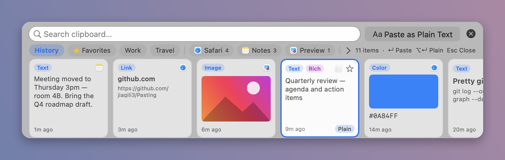

## Features

- **Automatic capture** of text, rich text (RTF/HTML), links, images, files and colors (`#RRGGBB` text or color-picker colors), with the source app's icon and name.
- **⇧⌘V panel** appears above your text cursor (falls back to the bottom center of the screen when the cursor position isn't available). ←/→ to select, ↵ to paste, ⌥↵ to paste as plain text, Esc or × to close. Mouse wheel scrolls the cards.
- **Search as you type** across text, titles, URLs, file names and app names (case-, accent- and width-insensitive; Chinese works).
- **Filter by app**: chips for your top source apps (scroll the row with the mouse wheel); **>** lists every other app and holds *New Favorite…* / *New Pinboard…*.
- **Paste as Plain Text** button in the panel's top bar, strips all formatting.
- **Favorites ⭐**: click the star in a card's top-right corner (or press ⌘D, or right-click → *Add to Favorites*). Favorites get their own tab right after *History* and **never expire**: they're exempt from retention and the item cap.
- **Edit favorites**: right-click → *Edit…*, the ✏️ on hover in the Favorites tab, or double-click a card's title. Give it a title shown on the card, and change the text or URL that gets pasted (editing rich text turns it into plain text). Images and files: title only. ⌘↵ saves, Esc cancels.
- **Add your own favorites**: the **+** next to *Favorites*, *New Favorite…* in the **>** menu, or right-click an empty Favorites tab. Titles and edited content are searchable.
- **Pinboards** (e.g. *Work*, *Travel*), plus **rename** and **delete**, all from the right-click menu.
- **History retention**: 1 day / **7 days (default)** / 30 days / forever, plus a max-items cap. Favorites and pinboard items are never auto-deleted.
- **Resizable panel**: Small / Medium / Large presets, sliders, or drag the edges.
- **Animated first-run guide**, a **Settings** window, and **English / 简体中文** (follows the system language by default; switch instantly).
- **Accessibility drag helper**: drag the Pasting icon straight into System Settings' Accessibility list; it confirms when access is granted.

| Favorites | Search | Filter by app | Pinboard |
|---|---|---|---|
| 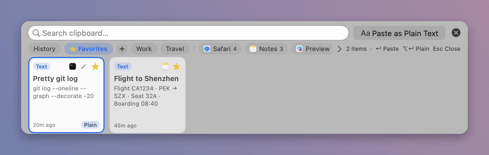 | 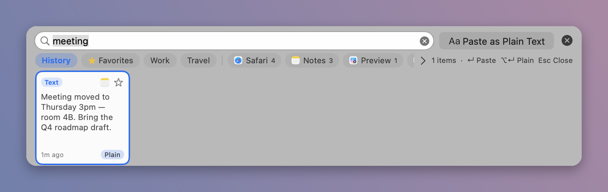 | 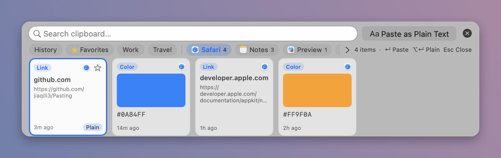 | 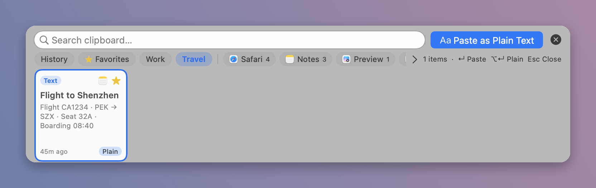 |

| Edit a favorite |
|---|
| 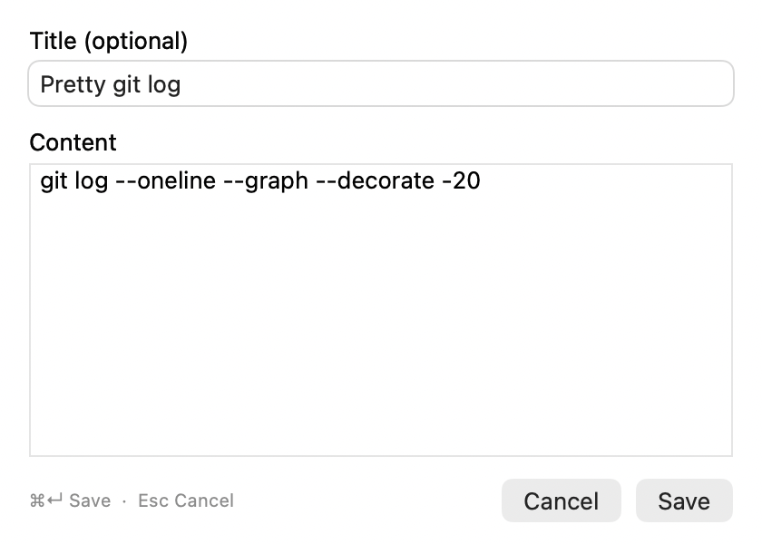 |

### First-run guide

| | | |
|---|---|---|
| 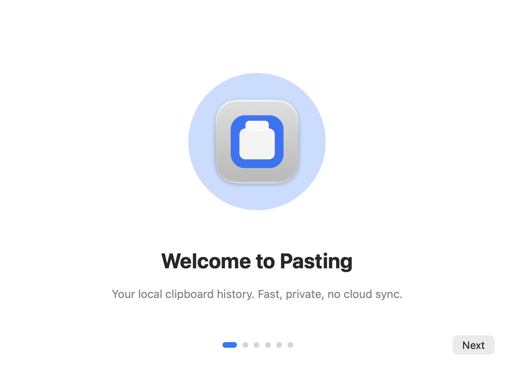 | 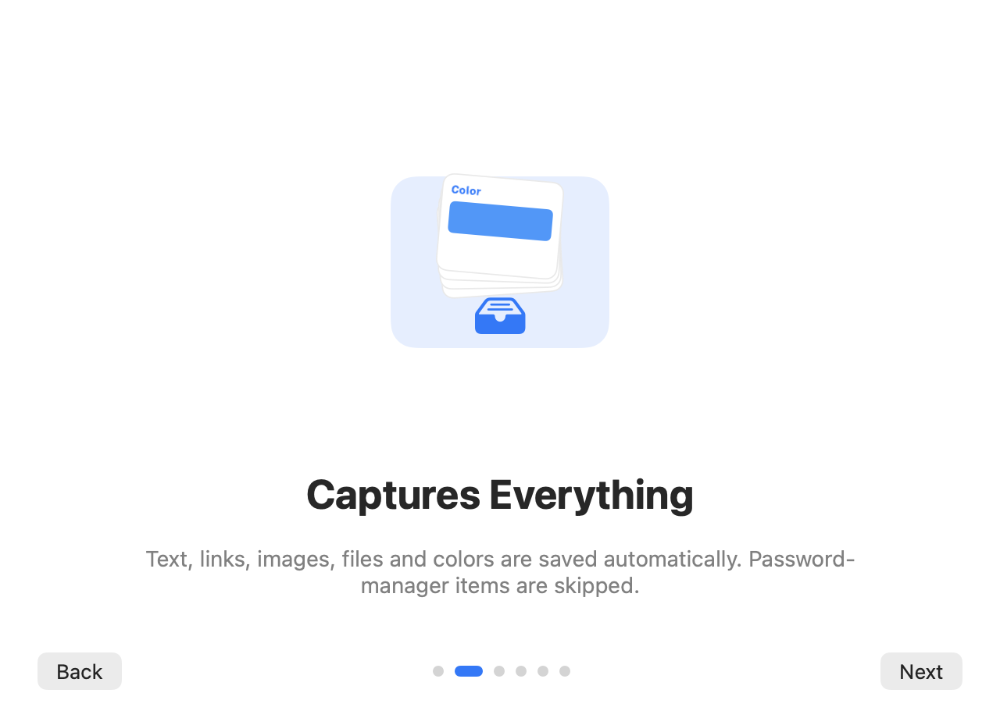 | 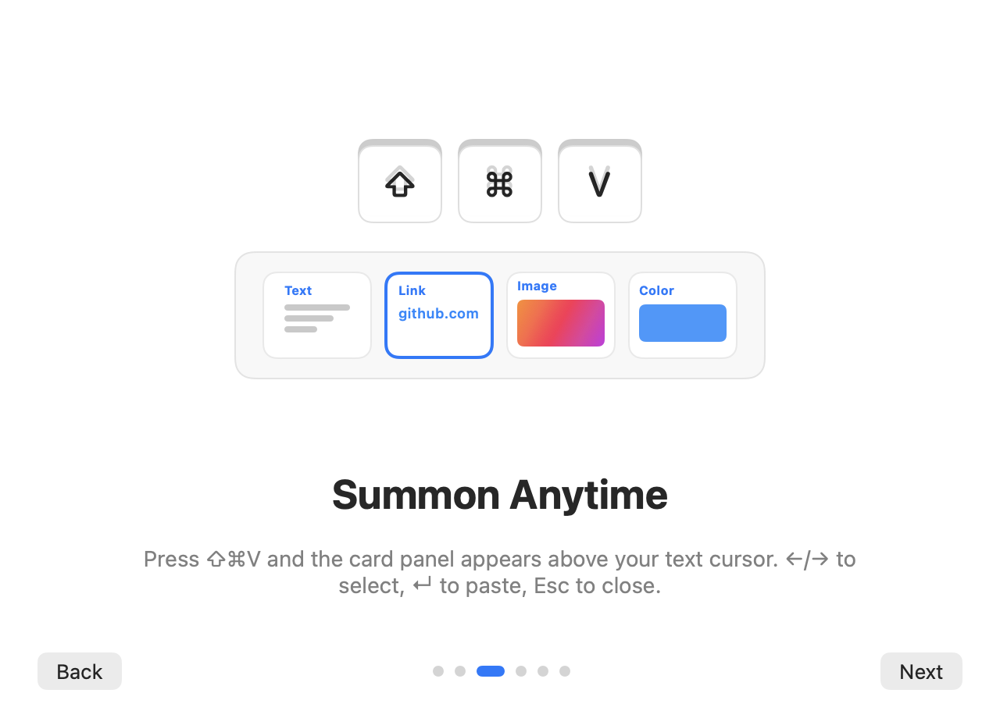 |
| 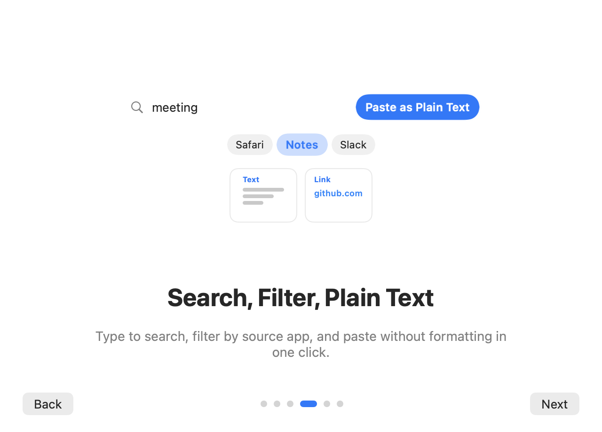 | 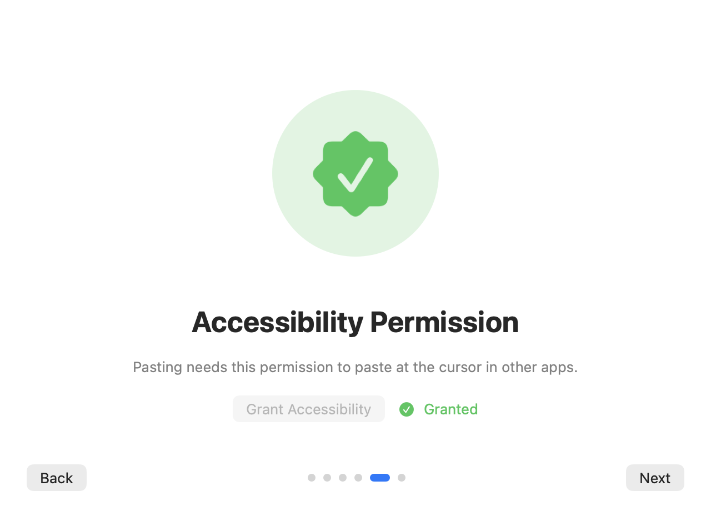 | 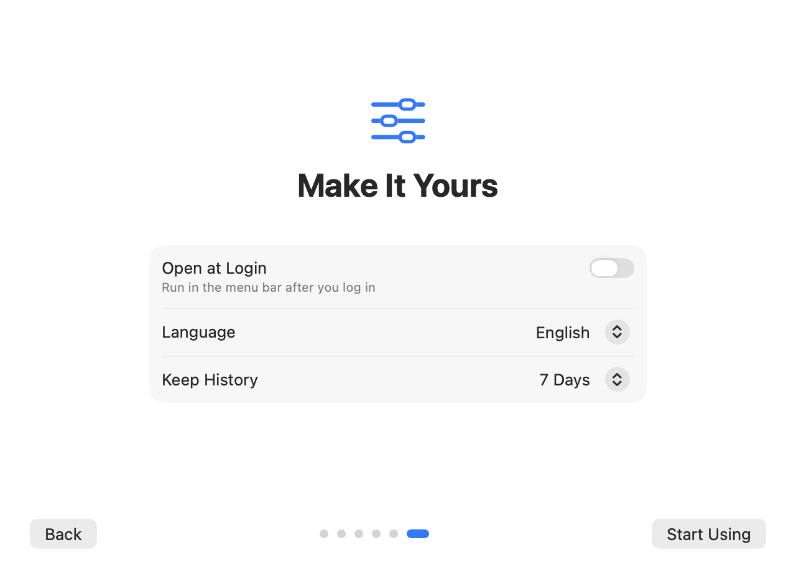 |

Accessibility helper:

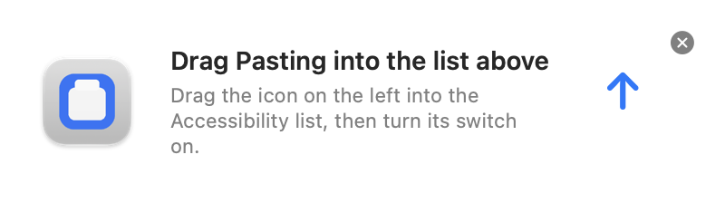

### Settings

| General | History | Privacy | About |
|---|---|---|---|
| 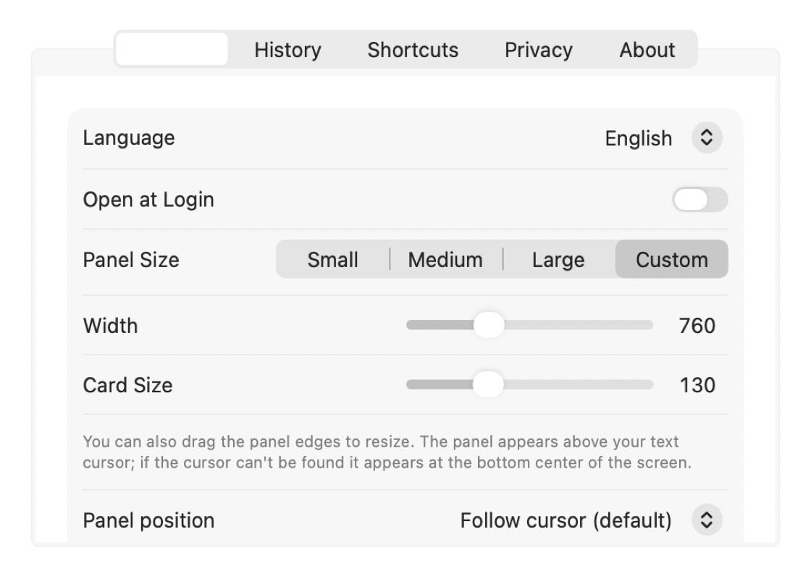 | 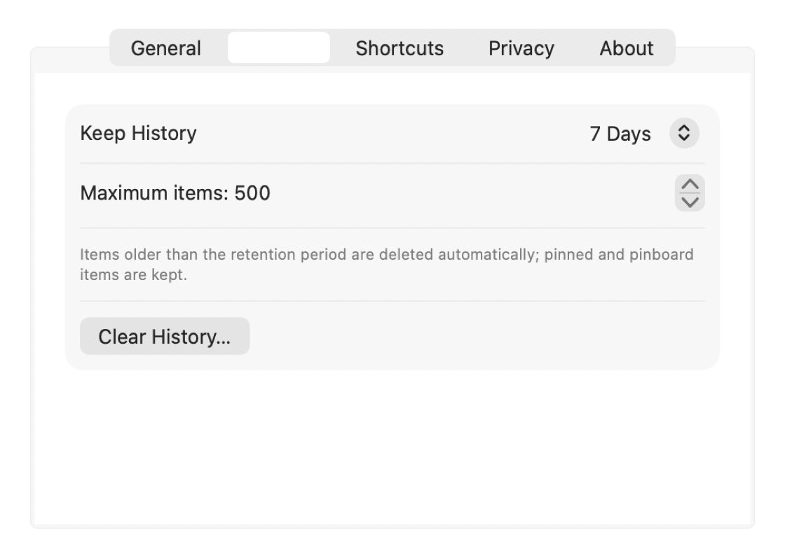 | 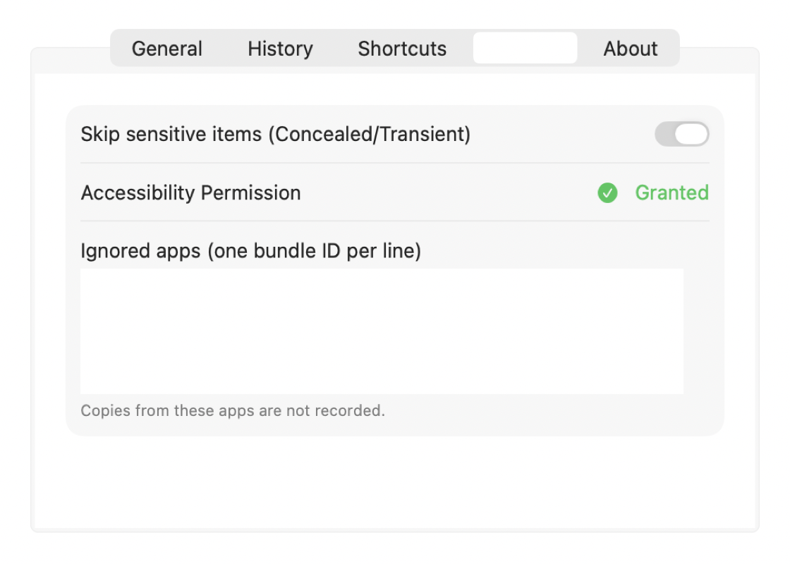 | 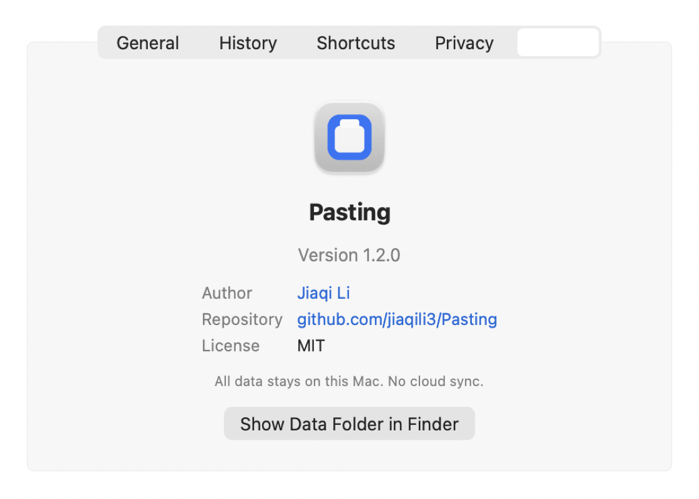 |

> Screenshots are rendered by the app itself from a built-in **demo dataset** (`--test screenshots`). No real clipboard data is shown.

## Install

### Download
Grab `Pasting.zip` from [Releases](https://github.com/jiaqili3/Pasting/releases), unzip, and move `Pasting.app` to `~/Applications` or `/Applications`.

### Build from source
Only the **Xcode Command Line Tools** are needed (no Xcode, no SwiftPM):

```bash
xcode-select --install          # if needed
git clone https://github.com/jiaqili3/Pasting.git
cd Pasting
./build_app.sh                  # compiles with swiftc, builds Pasting.app, ad-hoc signs, installs to ~/Applications
open ~/Applications/Pasting.app
```

Requires macOS 14 or later (Apple silicon; the build script targets arm64).

### First launch
1. The app is **ad-hoc signed**, not notarized. If Gatekeeper blocks it: right-click the app → **Open**, or go to **System Settings → Privacy & Security → Open Anyway**.
2. To paste directly into other apps, Pasting needs **Accessibility** permission. Click **Grant Accessibility** in the guide or Settings, then drag the icon from the helper into the list and turn it on. Without it, the selected item is still put on the clipboard so you can press ⌘V yourself. Accessibility also lets the panel find your text cursor.

## Shortcuts

| Key | Action |
|---|---|
| ⇧⌘V | Show / hide the panel |
| ← / → | Select previous / next card |
| ↵ / double-click | Paste the selected card into the previous app |
| ⌥↵ | Paste as plain text |
| Type | Search |
| ⌘A ⌘C ⌘V ⌘X ⌘Z | Edit the search field (⌘C with no text selected copies the selected card) |
| ⌘D | Add / remove favorite |
| ⌘, | Settings |
| Esc / × / click outside | Close |

## Privacy

- 100% local. No network code, no iCloud/CloudKit, no analytics.
- Items marked **Concealed / Transient** (password managers use these) are skipped; you can add **ignored apps** by bundle ID.
- History auto-expires after 7 days by default. *Clear History* is in the menu bar and Settings.
- The app is not sandboxed (it needs Accessibility to paste). Source code is fully available here.

## Performance

Measured on a MacBook Air (Apple silicon, macOS 27) with `tests/resource_test.sh`. The test uses an isolated temp data directory with 500 synthetic items including 100 large images.

| Metric | Result | Budget |
|---|---|---|
| Idle memory (phys footprint) | 20.7 MB | < 60 MB |
| With 500 items, all thumbnails loaded | 33–38 MB | < 150 MB |
| Growth over 50 panel open/close cycles | −1.3 MB (no leak) | < 5 MB |
| Panel open (avg / max) | 4.0 ms / 18 ms | < 50 ms |
| Idle CPU over 30 s | 0.10 % | < 1 % |
| Search 500 items | 0.2–3.8 ms per query | |
| Data on disk (500 items, 100 images) | 6.4 MB | |

## Documentation

- [System design](docs/SYSTEM_DESIGN.md): architecture, threading, data layout, design decisions
- [Changelog](CHANGELOG.md)

## Project layout

```
Sources/Pasting/   Swift sources (AppKit + SwiftUI)
Resources/         App icon
build_app.sh       Build, bundle, sign and install
tests/             Resource budget test
docs/              Design doc and screenshots
```

## License

[MIT](LICENSE) © Jiaqi Li
