[English](README.md) | **简体中文**

# Pasting

一个快速、私密、**只在本机运行**的 macOS 剪贴板管理器。按 **⇧⌘V**，剪贴板历史会以卡片的形式出现在文字光标上方：可以搜索、按应用筛选，带格式或以纯文本粘贴。

没有 iCloud，不需要账号，不联网。所有数据都在 `~/Library/Application Support/Pasting/`。

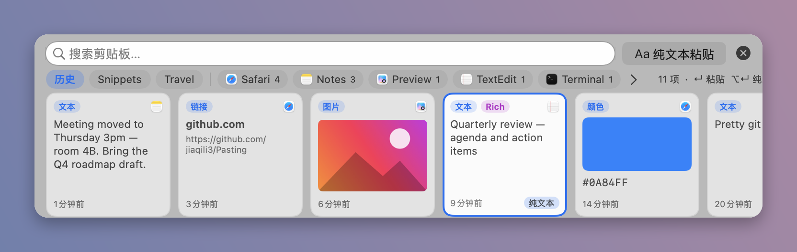

## 功能

- **自动记录**文字、富文本（RTF/HTML）、链接、图片、文件和颜色（`#RRGGBB` 文本或取色器颜色），并记下来源应用的图标和名称。
- **⇧⌘V 面板**出现在文字光标上方（拿不到光标位置时显示在屏幕底部中央）。←/→ 选择，↵ 粘贴，⌥↵ 纯文本粘贴，Esc 或 × 关闭，鼠标滚轮可横向滚动卡片。
- **边打字边搜索**：文字、标题、网址、文件名和应用名都能搜（不区分大小写、重音和全半角，支持中文）。
- **按应用筛选**：顶栏显示最常用的几个来源应用；点 **>** 可选其他应用，「新建分类…」也在这里。
- 顶栏的**纯文本粘贴**按钮，去掉所有格式后粘贴。
- **分类**（如 Snippets、Travel）、**置顶**、**重命名**、**删除**，都在右键菜单里。
- **历史保留**：1 天 / **7 天（默认）** / 30 天 / 永久，另有最多条数上限。置顶和分类里的条目不会被自动删除。
- **可调整面板大小**：小 / 中 / 大预设、滑块，或直接拖动边缘。
- 带动画的**首次使用引导**、**设置**窗口，支持 **English / 简体中文**（默认跟随系统语言，切换立即生效）。
- **辅助功能拖拽助手**：把 Pasting 图标直接拖进「系统设置」的辅助功能列表，授权成功后会自动提示。

| 搜索 | 按应用筛选 | 分类 |
|---|---|---|
| 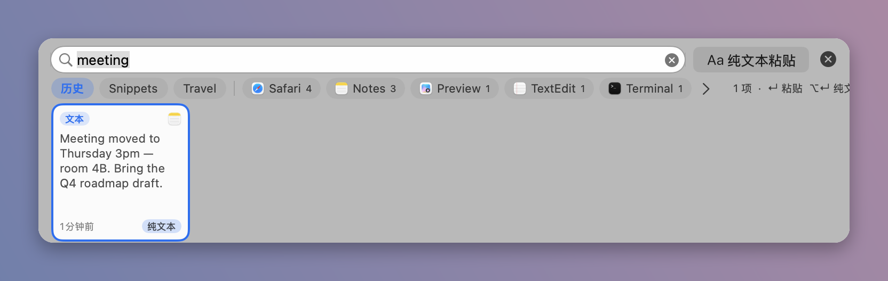 | 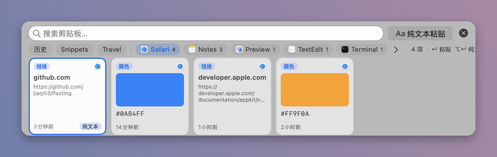 | 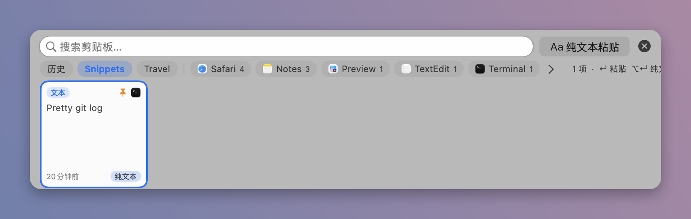 |

### 首次使用引导

| | | |
|---|---|---|
| 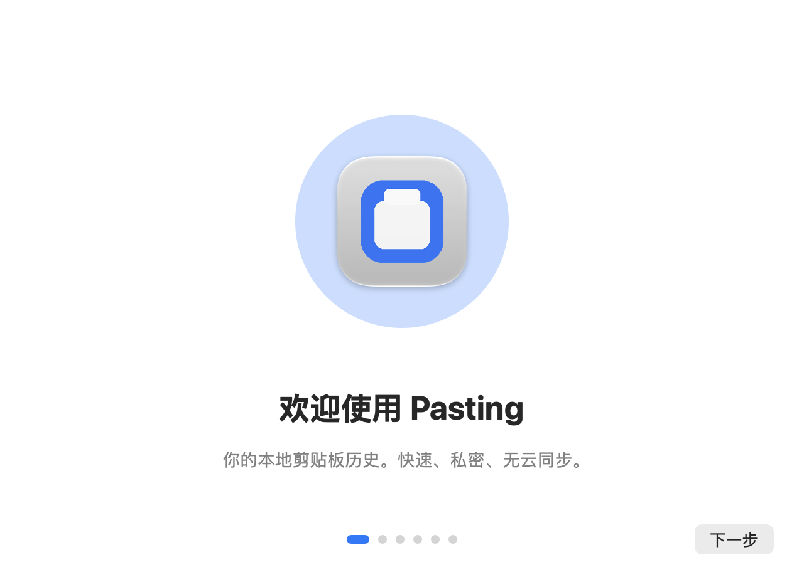 | 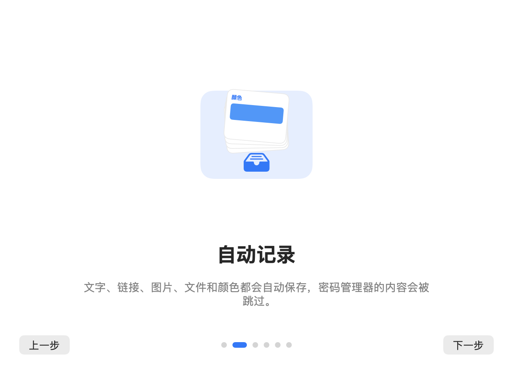 |  |
|  |  | 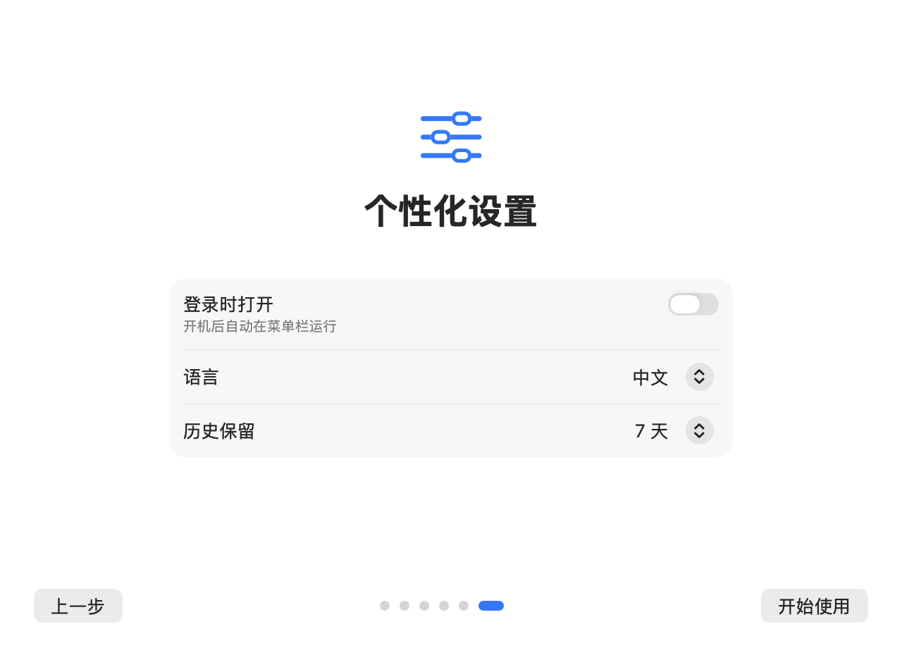 |

辅助功能助手：

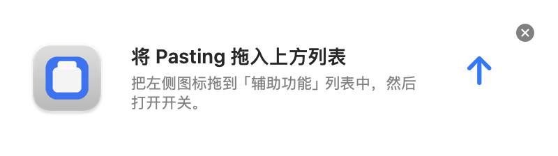

### 设置

| 通用 | 历史 | 隐私 | 关于 |
|---|---|---|---|
| 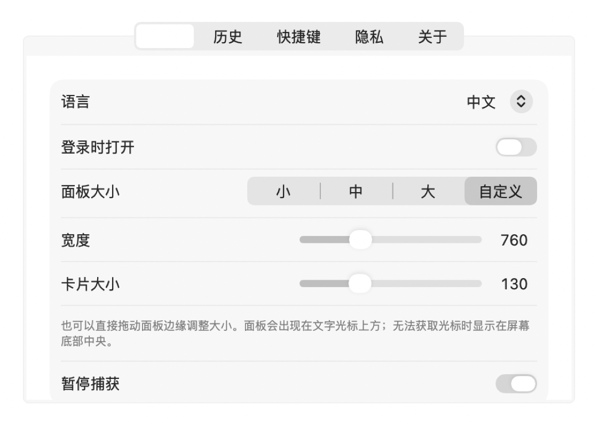 | 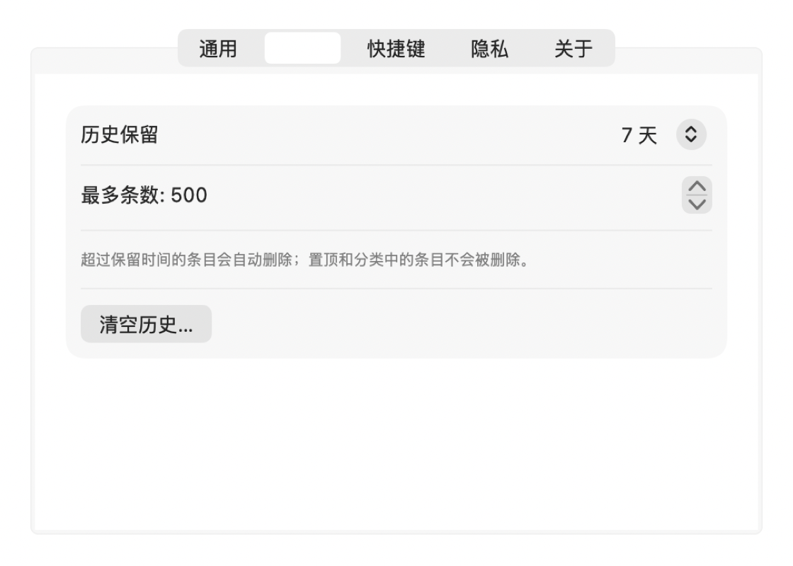 | 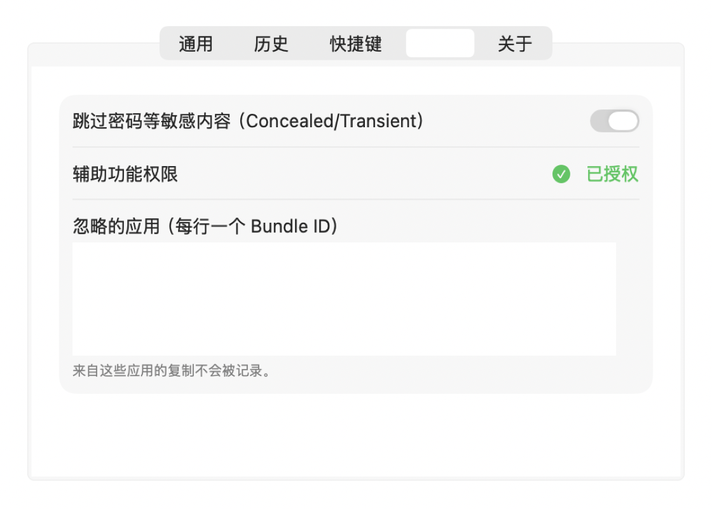 | 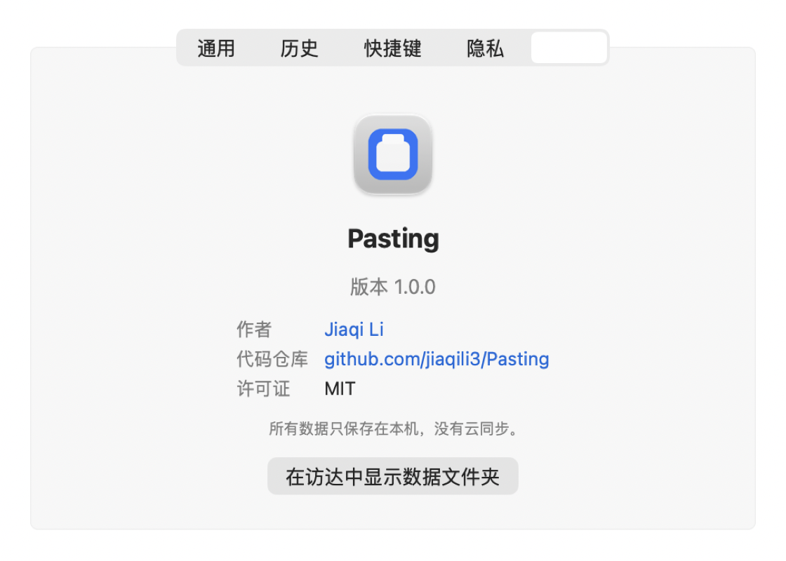 |

> 截图由 App 用内置的**演示数据**（`--test screenshots`）自己渲染，不包含任何真实剪贴板内容。

## 安装

### 下载
在 [Releases](https://github.com/jiaqili3/Pasting/releases) 下载 `Pasting.zip`，解压后把 `Pasting.app` 放进 `~/Applications` 或 `/Applications`。

### 从源码编译
只需要 **Xcode 命令行工具**（不需要 Xcode，也不用 SwiftPM）：

```bash
xcode-select --install          # 如未安装
git clone https://github.com/jiaqili3/Pasting.git
cd Pasting
./build_app.sh                  # 用 swiftc 编译、打包 Pasting.app、ad-hoc 签名并安装到 ~/Applications
open ~/Applications/Pasting.app
```

需要 macOS 14 或更高版本（Apple 芯片，构建脚本编译 arm64）。

### 首次打开
1. App 是 **ad-hoc 签名**，没有经过公证。如果被 Gatekeeper 拦截：右键 App →「打开」，或到「系统设置 → 隐私与安全性 → 仍要打开」。
2. 要直接粘贴到其他应用，Pasting 需要**辅助功能**权限。在引导或设置里点「授予辅助功能权限」，把助手里的图标拖进列表并打开开关即可。没有权限时，选中的内容仍会放到剪贴板上，你可以自己按 ⌘V。有了辅助功能权限，面板也才能找到文字光标的位置。

## 快捷键

| 按键 | 作用 |
|---|---|
| ⇧⌘V | 打开 / 关闭面板 |
| ← / → | 选择上一张 / 下一张卡片 |
| ↵ / 双击 | 粘贴选中的卡片到之前的应用 |
| ⌥↵ | 纯文本粘贴 |
| 直接打字 | 搜索 |
| ⌘A ⌘C ⌘V ⌘X ⌘Z | 编辑搜索框（搜索框里没选中文字时，⌘C 复制选中的卡片） |
| ⌘, | 设置 |
| Esc / × / 点面板外 | 关闭 |

## 隐私

- 完全本地运行。没有任何联网代码，没有 iCloud/CloudKit，没有统计。
- 标记为 **Concealed / Transient** 的内容（密码管理器会这样标记）会被跳过；还可以按 Bundle ID 设置**忽略的应用**。
- 历史默认 7 天后自动删除。菜单栏和设置里都有「清空历史」。
- App 没有沙盒（粘贴需要辅助功能权限）。全部源码都在这里。

## 性能

在 MacBook Air（Apple 芯片，macOS 27）上用 `tests/resource_test.sh` 实测。测试使用临时数据目录，含 500 条合成数据，其中 100 张是大尺寸图片。

| 指标 | 结果 | 预算 |
|---|---|---|
| 空闲内存（phys footprint） | 20.7 MB | < 60 MB |
| 500 条、缩略图全部加载后 | 33–38 MB | < 150 MB |
| 打开/关闭面板 50 次后的增长 | −1.3 MB（无泄漏） | < 5 MB |
| 打开面板（平均 / 最大） | 4.0 ms / 18 ms | < 50 ms |
| 空闲 30 秒的 CPU | 0.10 % | < 1 % |
| 在 500 条中搜索 | 每次 0.2–3.8 ms | |
| 磁盘占用（500 条，含 100 张图） | 6.4 MB | |

## 文档

- [系统设计](docs/SYSTEM_DESIGN.md)（英文）：架构、线程模型、数据布局、设计取舍
- [更新日志](CHANGELOG.md)（英文）

## 目录结构

```
Sources/Pasting/   Swift 源码（AppKit + SwiftUI）
Resources/         App 图标
build_app.sh       编译、打包、签名、安装
tests/             资源预算测试
docs/              设计文档和截图
```

## 许可证

[MIT](LICENSE) © Jiaqi Li
