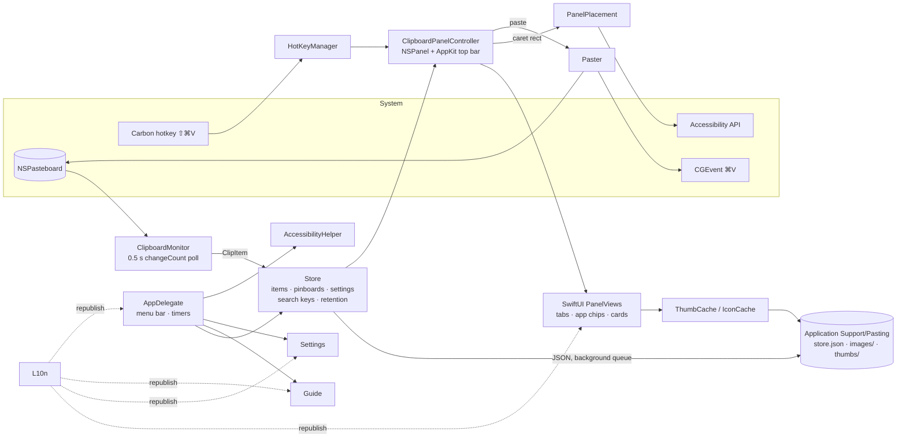

# Pasting — System Design

Pasting is a single-process, menu-bar-only macOS app (`LSUIElement`) written in Swift with AppKit and SwiftUI. It targets macOS 14+ and builds with the Command Line Tools alone.

## Architecture



## Components

| Component | File | Responsibility |
|---|---|---|
| ClipboardMonitor | `ClipboardMonitor.swift` | Polls `NSPasteboard.general.changeCount` every 0.5 s (timer tolerance 0.2 s). It reads files, images, colors, RTF/HTML and strings in that order. It skips Concealed/Transient/AutoGenerated types, ignored apps, and its own writes. |
| Store | `Store.swift`, `Models.swift` | Holds the items, pinboards and settings. Writes are debounced (0.8 s), encoded on main and written atomically on a utility queue. Maintains normalized search keys and enforces retention and the item cap. |
| ThumbCache / IconCache | `Caches.swift` | Thumbnails are made once with `CGImageSourceCreateThumbnailAtIndex` (max 280 px), kept in an `NSCache` (≤200 entries / 24 MB) and persisted in `thumbs/`. App and file icons are looked up once. |
| HotKeyManager | `HotKey.swift` | Carbon `RegisterEventHotKey` for ⇧⌘V, which needs no Input Monitoring permission. |
| ClipboardPanelController | `ClipboardPanelController.swift` | Pre-created `NSPanel` subclass (`.nonactivatingPanel`, `canBecomeKey = true`). The top bar (search field, plain-text button, close) is AppKit for reliable focus. Keyboard is handled by a local monitor (←/→, ↵, ⌥↵, Esc, ⌘-edit keys), and wheel events are mapped to horizontal scrolling. |
| PanelViews | `PanelViews.swift`, `PanelModel.swift` | SwiftUI tabs, app chips, ">" menu and an `Equatable` card row in a `LazyHStack`. State lives in an `ObservableObject` rather than `@State`, because the CLT toolchain lacks SwiftUI macro plugins. |
| PanelPlacement | `PanelPlacement.swift` | Caret rect via `AXFocusedUIElement → AXSelectedTextRange → AXBoundsForRange` (150 ms messaging timeout), converted from AX top-left to Cocoa coordinates. The panel goes 8 pt above the caret, horizontally centered and clamped, or below if there's no room. Falls back to bottom center. |
| Paster | `Paster.swift` | Writes the item to the pasteboard (plain-text mode writes only `.string`), reactivates the previous app, and posts ⌘V via `CGEvent` at HID level. Requires Accessibility. |
| AccessibilityHelper | `AccessibilityHelper.swift` | Opens Privacy → Accessibility and shows a floating, non-activating helper with a draggable app icon (`NSDraggingSource`, `public.file-url` of the bundle) positioned over the System Settings window. Window bounds come from `CGWindowList`, which needs no Screen Recording permission. It polls `AXIsProcessTrusted` every 0.5 s. |
| Guide / Settings | `Guide.swift`, `SettingsWindow.swift` | SwiftUI windows. Guide animations use `TimelineView(.animation)` and only run while the window is open; the hosting view is torn down on close. |
| L10n | `L10n.swift` | In-code zh-Hans/en table keyed by the Chinese string. Defaults to the system language (`zh*` → Chinese, else English) and republishes on change. |
| LoginItem | `LoginItem.swift` | `SMAppService.mainApp`, with a LaunchAgent fallback for ad-hoc signed builds. |
| TestMode / Screenshots | `TestMode.swift`, `Screenshots.swift` | `PASTING_DATA_DIR=… Pasting --test resources|axdrag|screenshots <dir>` runs isolated: no status item or hotkey, capture paused, invisible panel. |

## Data layout

```
~/Library/Application Support/Pasting/
  store.json      items (with base64 RTF/HTML), pinboards, settings
  images/<uuid>.png   captured images (full size)
  thumbs/<uuid>.png   downsampled thumbnails (regenerable)
~/Library/Logs/Pasting.log
```

New settings fields are optional so older `store.json` files keep decoding.

## Threading model

- Everything UI-related, the Store and the monitor run on the main thread. AppKit is main-thread by nature, and the code uses Swift 5 language mode to avoid fighting strict concurrency.
- Disk writes of `store.json` happen on a serial utility queue, and thumbnail pre-warming runs on a global utility queue.
- Search stays synchronous (≤4 ms for 500 items). Slow filters (>5 ms) are logged.

## Retention

`purgeExpired` runs at launch, hourly, on every capture and when the setting changes. It deletes unpinned, non-pinboard items older than N days, together with their image and thumbnail files. A self-test checks the rule on launch. The item cap (default 500) evicts the oldest unpinned items.

## Performance

From `tests/resource_test.sh` (500 synthetic items incl. 100 large images, isolated data dir):

| Metric | Result |
|---|---|
| Idle footprint | 20.7 MB |
| 500 items, all thumbnails loaded | 33–38 MB |
| 50 open/close cycles | −1.3 MB growth |
| Panel open | 4.0 ms avg, 18 ms max (first open with 500 items: ~120 ms) |
| Idle CPU (30 s) | 0.10 % |
| Search | 0.2–3.8 ms / query; index build 2.9 ms for 500 items |

Key decisions: build the panel once and only `orderFront` it; no show animation; no per-card shadows; `Equatable` cards; caches for thumbnails and icons; debounced background persistence.

## Privacy decisions

- No networking, no iCloud/CloudKit, no telemetry.
- Concealed/Transient pasteboard types are skipped by default, and an ignored-apps list is available.
- 7-day default retention.
- Tests and screenshots never read or write the real store; they use a temp directory and a demo dataset, and pause capture.

## Why `swiftc` instead of SwiftPM/Xcode

The target machine has only the Command Line Tools, and their SwiftPM `PackageDescription` library fails to link manifests. `build_app.sh` therefore compiles all sources with a single `swiftc -O` invocation, assembles the `.app` bundle (Info.plist, icon, PkgInfo), ad-hoc signs it with `codesign -s -` and installs it to `~/Applications`. `Package.swift` is kept for editors. SwiftUI property-wrapper macros (`@State`, `@FocusState`) are unavailable without Xcode's macro plugins, so view state uses `ObservableObject` and `@ObservedObject`.

## Known limitations

- Ad-hoc signed, not notarized, so Gatekeeper asks on first open. The Accessibility grant may need re-approving after a rebuild changes the signature.
- Caret positioning depends on the frontmost app exposing `AXBoundsForRange`. Some Electron or terminal apps don't, and the panel then uses the bottom-center position.
- The global hotkey is fixed to ⇧⌘V (display only in Settings).
- While a Chinese IME is composing, search updates after the candidate is committed.
- Copying text inside Pasting's own search field isn't recorded.
- arm64 only (the build script targets `arm64-apple-macos14.0`).
